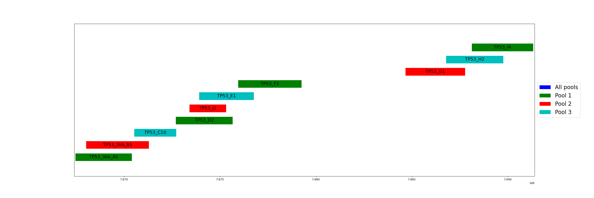

# QC

QC metrics are collected in a MultiQC report, `Results/Reports/{experiment}_{sample}_{type}_multiqc_amplicons.html`,
and in the Coverage sheets of the [Excel report](report.md).

## Sequencing run

`qc_ont_pycoqc` runs **[pycoQC](https://github.com/a-slide/pycoQC)** v2.5.0.23 on the `sequencing_summary*.txt` file written
by MinKNOW in the run folder. It reports the read count, read length and quality over the run.

## Read quality

`qc_ont_sequali` runs **[Sequali](https://sequali.readthedocs.io/en/latest/)** v0.12.0 twice: on the reads kept by Filtlong and
on the reads it discarded. Comparing both shows what filtering removed. The Filtlong log is also parsed by MultiQC.

## Coverage

All coverage values are computed with **[Mosdepth](https://github.com/brentp/mosdepth)** v0.3.6 on the soft-clipped BAM file.

| Rule | Regions | Use |
|------|---------|-----|
| `qc_mosdepth_amplicons` | `amplicons.bed` | Mean coverage per amplicon. |
| `qc_ont_mosdepth_overlap` | Each `{target}.bed` | Mean coverage per target, including `*_only` sub-regions. Used to estimate read counts. |
| `qc_mosdepth_bed_per_target` | Each target, on the per-target BAM file | Coverage thresholds (1, 5, 100, 500, 1000×). |
| `qc_mosdepth_bed_per_exon` | `exon_coverage.bed` | Mean coverage per exon; `qc_ont_mosdepth_exons_multiqc` turns it into a MultiQC table. |

`qc_ont_mosdepth_merge` merges the per-target summaries into `results/mosdepth/{experiment}_{sample}_{type}_coverage_per_amplicon.csv`.

## Yield per amplicon and per pool

Amplicons are 2–3 kb long and almost every read spans its whole amplicon, so the mean coverage of an amplicon approximates its number of reads.
For overlapping *TP53* amplicons, the coverage is taken from the region covered by one amplicon only (`*_only`).
For TP53_J3, which lies entirely inside TP53_D2, the count is `TP53_D2+J3` minus `TP53_D2_only`.

`qc_ont_yield_per_pool` writes, for each pool, the estimated read count and percentage of reads per amplicon
(`results/mosdepth/{experiment}_{sample}_{type}_yield_pool_{pooln}.csv`). This answers two questions:

* **Balance within a pool**: with 5 amplicons per pool, each should get about 20% of the pool's reads. A much higher share means
  that amplicon outcompetes the others in the multiplexed PCR; a much lower share means it is disfavoured.
* **Balance between pools**: each of the 3 pools should get about 33% of all reads. If not, adjust the volumes pipetted per pool before sequencing.

## Alignment metrics

**[Picard](https://broadinstitute.github.io/picard/)** v2.25.4 is used for:

* `qc_picard_collect_hs_metrics`: on-target and off-target bases with the amplicons as bait and target intervals
  (`COVERAGE_CAP=25000`). The interval list is created from `amplicons.bed` by `qc_ont_picard_bed_to_interval_list`.
  See [this Agilent note](https://www.agilent.com/cs/library/applications/an-long-read-sureselect-xt-hs2-5994-7612en-agilent.pdf)
  on using Picard metrics with long reads;
* `qc_picard_collect_alignment_summary_metrics`: alignment metrics for the whole sample, and per target
  (`qc_picard_collect_alignment_summary_metrics_per_target`).

## MultiQC

`qc_multiqc` (**[MultiQC](https://seqera.io/multiqc/)** v1.25.1) collects the files listed under `multiqc.reports.amplicons.qc_files`
in `config/config.yaml`, with the layout in `config/multiqc_config.yaml`. Sequali needs MultiQC 1.25.1 or later.

## Yield over time (research)

`qc_ont_mosdepth_overlap_timestep`, `qc_ont_mosdepth_merge_timestep` and `qc_ont_plot_yield_timestep` compute the cumulative
coverage per amplicon from the BAM batches that MinKNOW writes every `timestep_minknow` minutes, to see how fast each amplicon
reaches a given depth. These rules are kept for research and are not part of the default outputs.
